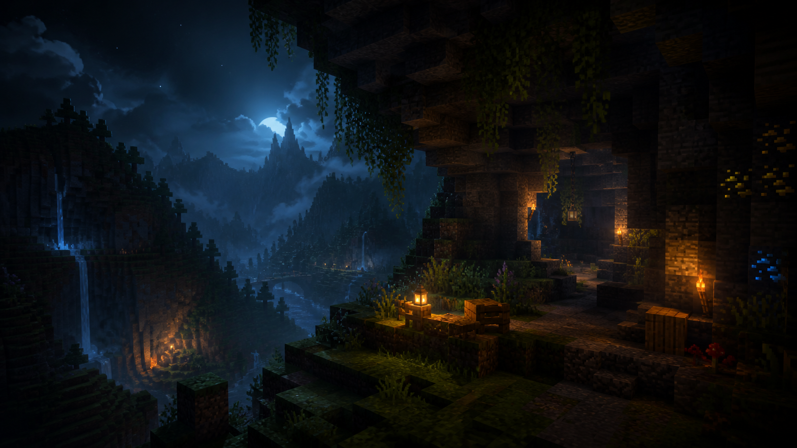

# HK Launcher

<div align="center">



**A modern, high-performance Minecraft Java Edition launcher built with Electron.**

[](LICENSE)
[](https://github.com)
[](https://www.electronjs.org/)
[](https://nodejs.org/)

</div>

---

## 📖 Overview

**HK Launcher** is an open-source, customizable Minecraft Java Edition launcher designed to provide a clean, responsive, and performance-optimized experience. Powered by Electron and Node.js, HK Launcher features an authentic, daylight-themed interface, native Microsoft OAuth authentication, dynamic Java environment discovery, seamless Fabric Loader integration, and a built-in Modrinth mod manager.

Whether you are looking to launch lightweight vanilla instances, dive into heavily modded Fabric worlds, or tune Minecraft's memory and graphics for maximum FPS on low-end hardware, HK Launcher provides the tools out of the box without complicated configuration.

---

## ✨ Features

### 🎮 Game & Version Management
- **Official Mojang Manifest Integration**: Fetches and installs official releases, release candidates, snapshots, and legacy versions directly from Mojang servers.
- **Fabric Loader Support**: Automatic detection and installation of Fabric profiles, libraries, and loader versions.
- **Offline Mode & Local Version Caching**: Automatically caches manifests and detects previously installed Minecraft versions on disk. Play offline when internet connectivity is unavailable with clear UI indicators.
- **Multi-Instance Isolation**: Per-profile instance directories (`mods/`, `resourcepacks/`, `shaderpacks/`, `screenshots/`, `saves/`, `logs/`).

### ☕ Advanced Java Runtime Management
- **Dynamic Java Scanner**: Automatically scans `JAVA_HOME`, system `PATH` (`where.exe java`), the Windows Registry (`HKLM\SOFTWARE\JavaSoft`, `HKLM\SOFTWARE\WOW6432Node\JavaSoft`, Adoptium keys), and vendor directories (Eclipse Temurin, Amazon Corretto, Microsoft OpenJDK, Azul Zulu, Oracle JDK, Android Studio JBR).
- **Exact Version Verification**: Executes `java.exe -version` to verify vendor, architecture, and exact version strings.
- **Version Compatibility Matching**:
  - Automatically pairs **Java 21+** with Minecraft 1.20.5 and newer.
  - Automatically pairs **Java 17+** with Minecraft 1.18 through 1.20.4.
  - Automatically pairs **Java 8** with legacy versions (1.16.5 and older).
- **Automatic Portable Java Downloader**: One-click download of official Mojang JRE runtimes (`java-runtime-delta`, `java-runtime-beta`, `jre-legacy`) with SHA1 checksum validation into isolated launcher storage.

### 🧩 Mods & Resource Packs
- **In-App Modrinth Integration**: Direct search and one-click installation via the official Modrinth API (`https://api.modrinth.com/v2`).
- **Curated Performance Suite**: Pre-configured discovery for popular optimization mods: **Sodium, Lithium, Iris Shaders, FerriteCore, Entity Culling, ImmediatelyFast, ModernFix, Fabric API, and Indium**.
- **Automated Dependency Resolution**: Recursively resolves and installs required mod dependencies with SHA512 checksum integrity verification.
- **HTML5 Drag-and-Drop**: Drag `.jar` mods into the Mods panel or `.zip` resource packs into the Packs panel for instant import with duplicate and overwrite protection.
- **Mod Manager**: Toggle, update, or uninstall mods directly from the launcher interface.

### 🔐 Account & Security Architecture
- **Interactive Microsoft Authentication**: Official Microsoft OAuth login window with Xbox Live, XSTS, and Minecraft Services authentication.
- **Secure Token Encryption**: Access tokens encrypted using Electron `safeStorage` (Windows DPAPI).
- **Offline / Local Profiles**: Create local singleplayer accounts without requiring external credentials.
- **Zero Password Collection**: Never stores or prompts for Microsoft passwords.
- **Server Login Vault**: Encrypted client-side storage for local server passwords with one-click clipboard copying.

### ⚡ Smart FPS & Performance Optimizer
- **Hardware Tier Scanner**: Analyzes CPU cores, GPU vendor, and system RAM to classify machine performance.
- **Dynamic Tuning Recommendations**: Recommends optimal RAM allocation, render distance, simulation distance, and JVM garbage collection arguments (`G1GC`).
- **Configurable Display Settings**: Custom window dimensions, fullscreen toggle, vsync, entity distance scaling, smooth lighting, and FPS limits.

---

## 🖼️ Screenshots

<div align="center">

### Main Launcher Dashboard


*(Additional screenshots of the Modrinth catalog, Accounts manager, and Java settings are located in the repository assets)*

</div>

---

## 🚀 Getting Started

### System Requirements
- **Operating System**: Windows 10 or Windows 11 (64-bit)
- **Node.js**: v18.0.0 or higher
- **npm**: v9.0.0 or higher
- **Java**: Java 8, 17, or 21 (or use the built-in automatic Mojang Java downloader)

### Installation & Development Setup

1. **Clone the repository**:
   ```bash
   git clone https://github.com/husainkaydawala7-creator/HK-Launcher.git
   cd HK-Launcher
   ```

2. **Install project dependencies**:
   ```bash
   npm install
   ```

3. **Verify configuration layout**:
   ```bash
   npm run check
   ```

4. **Launch the development build**:
   ```bash
   npm start
   ```

---

## 📦 Building the Application

To build the standalone Windows setup installer (`.exe`) using `electron-builder`:

```bash
npm run dist
```

The compiled installer and unpacked binaries will be generated in the `dist/` directory:
- **Installer**: `dist/HK-Launcher-Setup-0.1.0.exe`
- **Unpacked Portable App**: `dist/win-unpacked/HK Launcher.exe`

---

## 📁 Project Structure

```text
HK-Launcher/
├── .github/                       # GitHub workflows and issue templates
├── launcher-app/                  # Core Electron application
│   ├── main.js                    # Main process (IPC handlers, process launcher, OAuth)
│   ├── preload.js                 # Secure context isolation bridge
│   ├── services/                  # Modular backend services
│   │   ├── javaManager.js         # Dynamic registry/path Java scanner & JRE downloader
│   │   ├── modrinthService.js     # Modrinth v2 API client & dependency resolver
│   │   ├── offlineCache.js        # Offline detection & metadata disk cache
│   │   ├── dragDropHandler.js     # Secure HTML5 drag-and-drop file importer
│   │   └── index.js               # Service exports index
│   ├── renderer/                  # Frontend user interface
│   │   ├── index.html             # Main launcher window markup
│   │   ├── renderer.js            # UI interaction, state management & IPC invocations
│   │   ├── styles.css             # Bright daylight Minecraft styling
│   │   └── assets/                # Visual assets, SVG icons, and banners
│   └── scripts/                   # Verification and maintenance scripts
├── src/
│   └── fpsOptimizer/              # Hardware scanner, classifier & recommendation engine
├── minecraft-client-mod/          # Optional Fabric client helper mod source
├── netlify-site/                  # Project landing page and web assets
├── LICENSE                        # Apache License 2.0
├── NOTICE                         # Copyright and third-party attribution notice
├── CONTRIBUTING.md                # Open-source contribution guidelines
└── package.json                   # Project manifest, dependencies, and build config
```

---

## 🛠️ Technologies Used

| Technology | Purpose |
| :--- | :--- |
| **Electron** | Cross-platform desktop runtime with native window management |
| **Node.js** | Backend filesystem, IPC streaming, and child process management |
| **adm-zip** | In-memory ZIP archive manipulation for mod metadata and extraction |
| **Modrinth API v2** | Official API for searching, resolving, and downloading Minecraft mods |
| **FabricMC** | Lightweight, modular Minecraft modding toolchain |
| **Mojang Launcher APIs** | Official product manifests for Minecraft versions and Java runtimes |
| **HTML5 / CSS3 / Vanilla JS** | Lightweight, responsive UI without heavy frontend frameworks |

---

## 🗺️ Roadmap

- [x] Dynamic Java discovery across Registry, PATH, and third-party vendors
- [x] In-app Modrinth mod browser with automatic dependency resolution
- [x] Drag-and-drop importer for mods and resource packs
- [x] Offline mode with local version disk caching
- [x] Official Mojang portable Java runtime downloader
- [ ] Forge, NeoForge, and Quilt mod loader installers
- [ ] In-app screenshot gallery and world backup tools
- [ ] Automated background self-updater
- [ ] Cross-platform support (Linux and macOS builds)

---

## 🤝 Contributing

Contributions are welcome! Please read our [Contributing Guidelines](CONTRIBUTING.md) to learn how to fork the repository, adhere to security practices, and submit pull requests.

---

## 📄 License

This project is licensed under the **Apache License, Version 2.0**.  
See the [LICENSE](LICENSE) file for the complete license text.

```text
Copyright 2026 Husain Kaydawala

Licensed under the Apache License, Version 2.0 (the "License");
you may not use this file except in compliance with the License.
You may obtain a copy of the License at

    http://www.apache.org/licenses/LICENSE-2.0

Unless required by applicable law or agreed to in writing, software
distributed under the License is distributed on an "AS IS" BASIS,
WITHOUT WARRANTIES OR CONDITIONS OF ANY KIND, either express or implied.
See the License for the specific language governing permissions and
limitations under the License.
```

---

## ⚠️ Disclaimer

HK Launcher is an independent open-source project and is **not an official Minecraft product**.  
It is not approved by, endorsed by, or associated with **Mojang Studios** or **Microsoft Corporation**.  
"Minecraft" is a registered trademark of Mojang Synergies AB.
